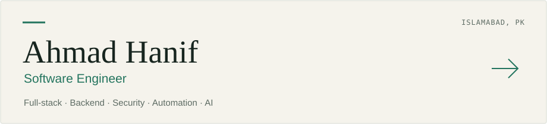
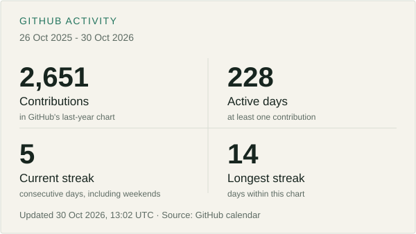
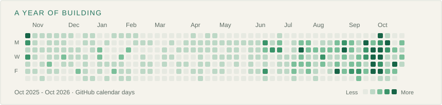

[**Portfolio ↗**](https://ahmadhanif.pk) &nbsp; / &nbsp; [Email](mailto:email@ahmadhanif.pk) &nbsp; / &nbsp; [LinkedIn](https://linkedin.com/in/ahmadhaneef)

I build full-stack applications, backend systems, security tools, and automation. I work across the interface, the API, the background jobs, and the deployment that keeps it running.

Currently a **Full Stack AI Engineer at SageTeck**, with a foundation in cybersecurity. AI and speech systems are part of my toolkit alongside product development, integrations, and developer tools.

---

## Selected projects

**[Narwhal Authentication ↗](https://github.com/AhmadHanif12/Narwal-Authentication)** 
An experimental authentication prototype exploring challenge-response and zero-knowledge proof concepts. Browser registration and login with Flask, JavaScript, and SQLite. 
Python · Flask · JavaScript · SQLAlchemy

**[EasyClaude ↗](https://github.com/AhmadHanif12/EasyClaude)** 
A Windows and Linux system-tray launcher that opens Claude Code in the right project directory. Global hotkey, folder picker, saved preferences, and terminal detection. 
Python · Tkinter · pystray · pynput

**IntraSec** 
Client-less network inventory and risk assessment, with asset discovery, alerts, and patch guidance. 
Next.js · Go · Python · PostgreSQL

**[TechMart ↗](https://github.com/AhmadHanif12/TechMart)** 
A commerce dashboard connecting sales, inventory, forecasting, and reorder suggestions with background processing and live updates. 
FastAPI · React · TypeScript · PostgreSQL · Redis · Celery

**[PORT Guard ↗](https://github.com/AhmadHanif12/Port-Scanning-Automation)** 
A team project that turns Nmap scan configuration and XML results into a browsable web interface. 
Python · Flask · Nmap · JavaScript

[More about my work →](https://ahmadhanif.pk)

## Working set

**Applications & data** 
TypeScript, JavaScript, React, Next.js, Python, FastAPI, Flask, PostgreSQL, SQLAlchemy, Redis, Supabase.

**Security, automation & delivery** 
Authentication, RBAC, tenant isolation, network assessment, n8n, ARQ, Celery, Docker, Linux, production troubleshooting.

**AI & speech** 
Gemini, Claude, Grok, DeepSeek, Whisper, NVIDIA Parakeet, Nemotron ASR, and NeMo Sortformer. Structured outputs, speech recognition, and speaker diarization.

## Activity

**730+ pull requests opened** across public and private repositories. 
A verified milestone from October 2026, rather than a live all-time counter. [Public PR history ↗](https://github.com/pulls?q=is%3Apr+author%3AAhmadHanif12)

From GitHub's last-year contribution calendar, including the private activity GitHub makes public as anonymous counts. These are contributions, not just commits. Daily streaks include weekends; today's streak has until the end of the day to continue. Refreshes every six hours; the cards show their update time. [How GitHub counts contributions ↗](https://docs.github.com/en/account-and-profile/reference/profile-contributions-reference)

---

[ahmadhanif.pk](https://ahmadhanif.pk) &nbsp; · &nbsp; [email@ahmadhanif.pk](mailto:email@ahmadhanif.pk)
